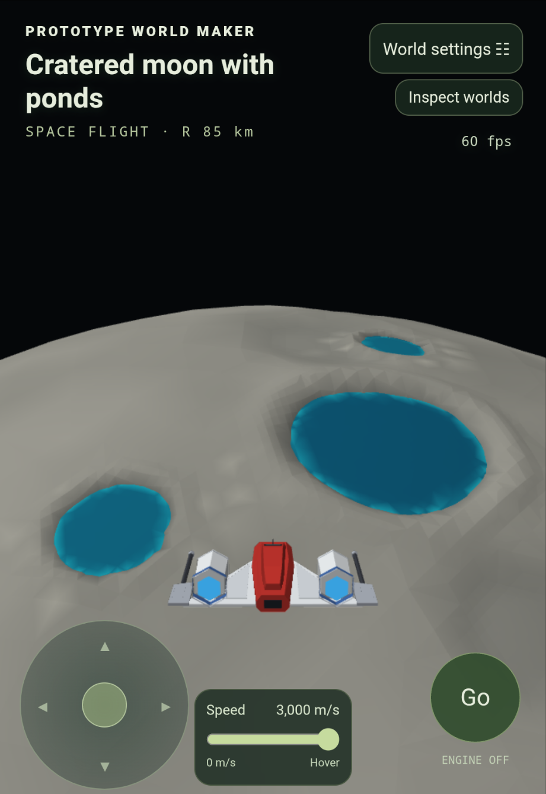
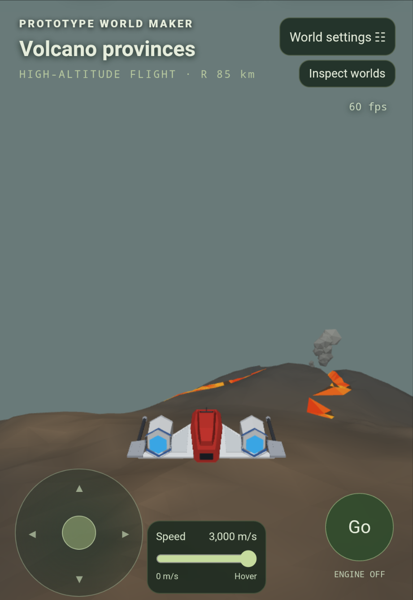
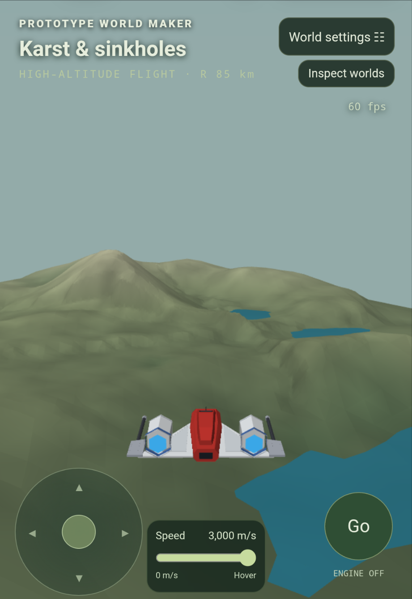
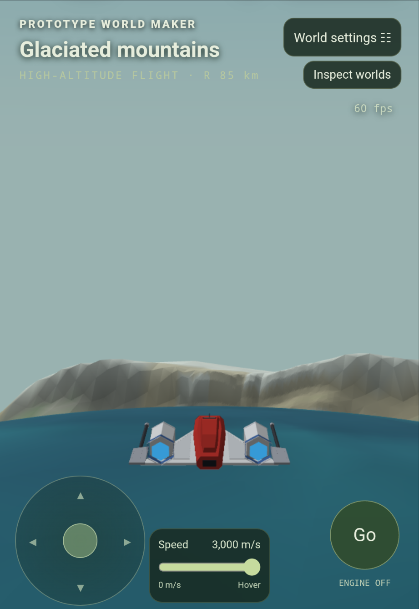
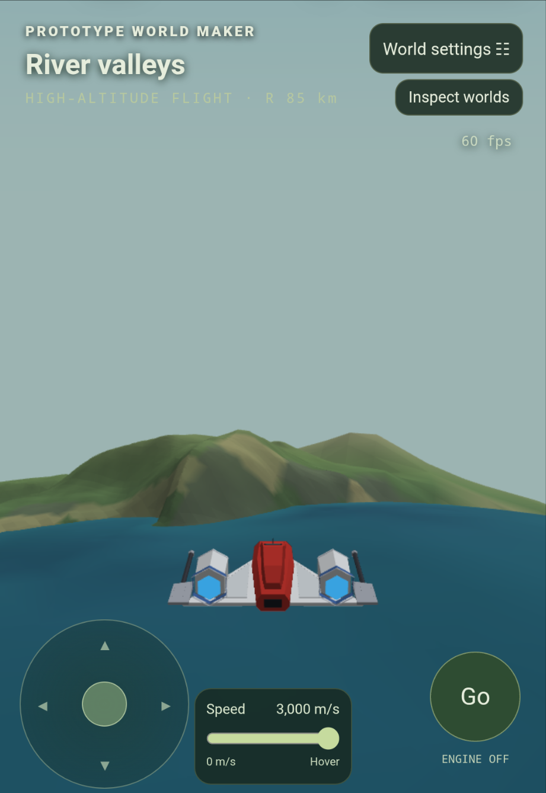
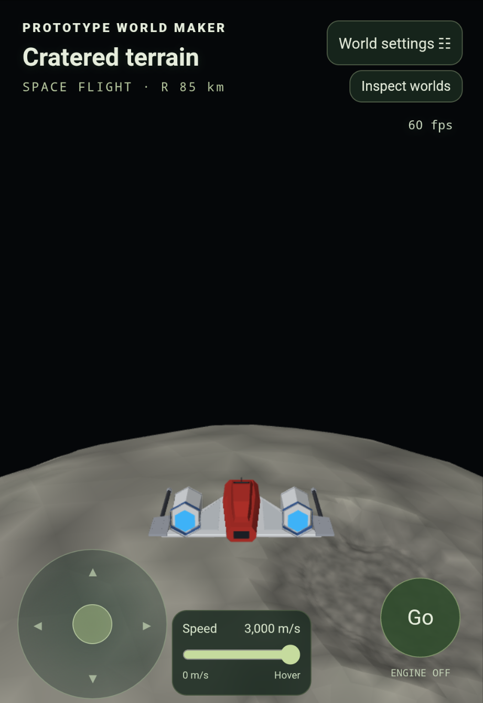

# Terrainmakerv1

A low-poly procedural planet designer and spaceflight prototype. Create and reseed worlds, mix compatible terrain types, and fly from the surface into space using touch controls and terrain collision protection.

## Run

Download this repository and open **index.html** in a modern browser with WebGL 2 enabled. The game is self-contained: no build step, external libraries or asset downloads are required. If your browser restricts local files, serve this folder with any static web server.

## Features

- 33 world choices, including volcanic terrain, crater ponds, icy moons, reefs, canyons and river valleys.
- Six seeded tile variants per terrain family, with adjustable world size, relief and mesh budget.
- Single terrain families by default; optional curated mixes of two or three compatible families.
- Low-poly spacecraft with adjustable speed, optional slope following and terrain collision protection.
- Orbit and surface inspection views, including views from above and below.
- GLB mesh export, JSON recipe import/export and terrain map PNG/data export.

The former world photo/snapshot and collage exporter has been removed.

## Normalised terrain mixer

Open **Terrain mixer** at the top right, then choose a batch seed and either two,
three, or a random number of source tiles. Ten candidates appear progressively;
select any finished tile to inspect it in the shared 3D view. Drag to turn,
scroll or pinch to zoom, or use the view buttons. Arrow keys rotate the focused
3D view and plus/minus zoom.

The mixer samples local height grids from the same landform functions used by
the planet's 27 terrain families and six designs per family. It does not build
whole donor planets or simulate their climate, water, thermal districts or
materials. Each input is scaled independently to `[-1, 1]`, then combined with
seeded signed weights and multiplication terms. The final grid is normalised
again. Rotations, offsets, variants and seeds are retained in the recipe.

Generation starts only when requested. A background worker streams ten 65 × 65
height grids; a single 3D canvas renders only the selected terrain, on demand.
The flight view pauses rendering while the mixer is open. Browsers that block
workers use a fallback that yields between tiles. Closing or cancelling stops
the batch. The mixer remains self-contained and adds no dependencies.

Use **Keep favourite** to retain up to 24 recipes in this browser. **Save recipe**
and **Open mix recipe** reproduce a terrain across sessions or devices. Exports
include a greyscale PNG, full precision JSON height data, and a coloured GLB
terrain patch. The height-range slider applies to the 3D view and the JSON/GLB
exports. Patches span 16 km; PNGs encode the normalised heights as 8-bit greyscale.
The mixer is a separate tile experiment; it does not replace the current planet.

Run the mixer checks with `node --test tests/terrain-mixer.test.cjs`.

## Controls

| Control | Action |
| --- | --- |
| Left touch pad | Pitch up/down and bank left/right |
| Go / Stop | Toggle engines; stopped craft hovers |
| Speed slider | Set flight speed |
| Craft | Camera and optional slope-following settings |
| W / S | Thrust |
| A / D | Turn |
| Arrow up / down or drag | Pitch |
| E / Q | Lift / drop |
| Shift | Boost |
| Space | Brake |
| P | Pause |
| Orbit / Inspect worlds | Examine terrain and switch inspection views |

Pitch holds when you release the touch pad. Slope following is optional; collision protection remains active.

## Screenshots

These are cropped from the supplied gameplay screenshots. Phone, browser and chat controls have been removed. They show the previous title before the Terrainmakerv1 rename.

| Terraced canyons | Cratered moon with ponds | Volcano provinces |
| --- | --- | --- |
|  |  |  |

| Karst and sinkholes | Glaciated mountains | River valleys | Cratered terrain |
| --- | --- | --- | --- |
|  |  |  |  |

## License

[MIT](LICENSE) — Copyright (c) 2026 Rick3y (rickey1990).

